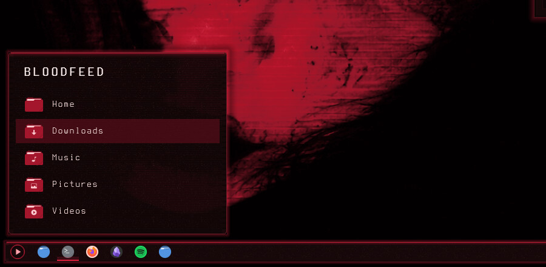
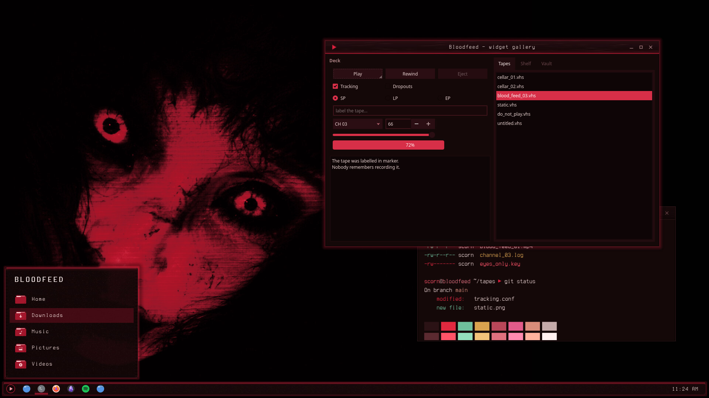

# Bloodfeed — Plasma Style

Blood-black glass for the Plasma panel, popups and tooltips: tiled VHS scanlines and grain, a crimson glow seam and crimson-tinted shadows.



Bloodfeed is a blood-dubbed VHS look for KDE Plasma 6, built around a crimson-lit face on near-black: blood-black surfaces, faint scanlines and tape grain, and a slight crimson glow on whatever has focus.

## Features

- Panel, popups/dialogs, tooltips and widget backgrounds in blood-black glass.
- VHS scanlines and tape grain tiled at 1:1, so they never smear or stretch at any panel size.
- A thin crimson seam along the top edge with a soft glow below it, and shadows with a faint crimson bleed nearest the frame.
- Translucent variants with blur and contrast behind them, plus solid variants for when compositing is off.
- Everything else (buttons, sliders, task highlights) falls back to Breeze and follows your colour scheme, so the Bloodfeed colour scheme is recommended.



## Requirements

Plasma 6.

## Install

```bash
git clone https://github.com/numbpill3d/bloodfeed-plasma
cd bloodfeed-plasma && ./install.sh
```

Or from the KDE Store: System Settings → Colors & Themes → Plasma Style → Install from File, or extract to `~/.local/share/plasma/desktoptheme/`.

## The rest of the suite

| piece | repo |
|---|---|
| SDDM login | [bloodfeed-sddm](https://github.com/numbpill3d/bloodfeed-sddm) |
| Plymouth boot splash | [bloodfeed-plymouth](https://github.com/numbpill3d/bloodfeed-plymouth) |
| Global theme + splash screen | [bloodfeed-global](https://github.com/numbpill3d/bloodfeed-global) |
| Aurorae window decoration | [bloodfeed-aurorae](https://github.com/numbpill3d/bloodfeed-aurorae) |
| Colour scheme | [bloodfeed-colors](https://github.com/numbpill3d/bloodfeed-colors) |
| Kvantum widget style | [bloodfeed-kvantum](https://github.com/numbpill3d/bloodfeed-kvantum) |
| Icon theme | [bloodfeed-icons](https://github.com/numbpill3d/bloodfeed-icons) |
| Konsole + kitty colours | [bloodfeed-konsole](https://github.com/numbpill3d/bloodfeed-konsole) |

Everything at once, with the generators: [bloodfeed](https://github.com/numbpill3d/bloodfeed).

## Tags

`bloodfeed` `kde` `plasma6` `dark` `vhs` `scanlines` `crimson` `red` `blood` `horror` `retro` `analog-horror` `glow` `plasma-style` `desktoptheme` `panel` `plasma-theme` `translucent` `blur`

## Credits and licence

By splicer scorn (voidrane). GPL-3.0-or-later.
